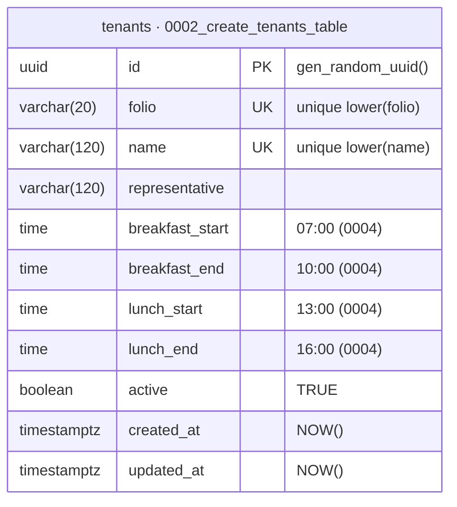
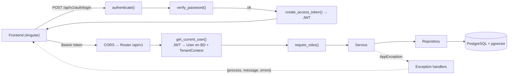

| Tabla | Ruta | Versión |
|---|---|---|
| tenants | /home/davidcv/proyectos/Backend_Beca_Alimentaria/alembic/versions/0002_create_tenants_table.py | 0002_create_tenants_table |
| users | /home/davidcv/proyectos/Backend_Beca_Alimentaria/alembic/versions/0003_create_users_table.py | 0003_create_users_table |



```mermaid
erDiagram
    TENANTS["tenants · 0002_create_tenants_table"] ||--o{ USERS["users · 0003_create_users_table"] : "tenant_id"

    TENANTS {
        uuid id PK
    }

    USERS {
        uuid id PK "gen_random_uuid()"
        uuid tenant_id FK "NULL solo si SUPERADMIN"
        varchar(20) role "SUPERADMIN | ADMIN | CHECKER"
        varchar(30) username UK "unique lower(username)"
        varchar(120) email UK "unique lower(email)"
        varchar(255) password_hash ""
        varchar(120) full_name ""
        varchar(15) phone ""
        boolean active "TRUE"
        timestamptz last_login_at "nullable"
        timestamptz created_at "NOW()"
        timestamptz updated_at "NOW()"
    }
```


